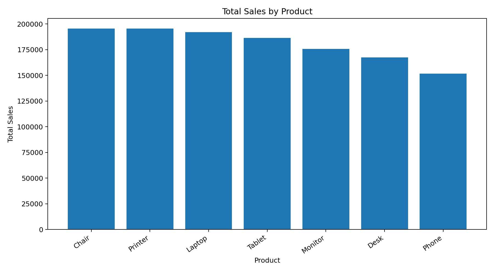
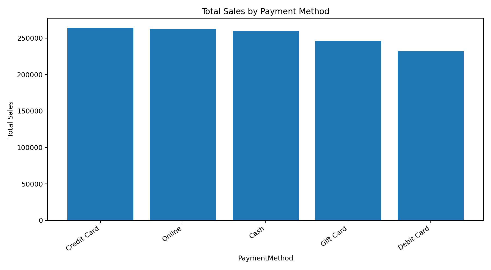
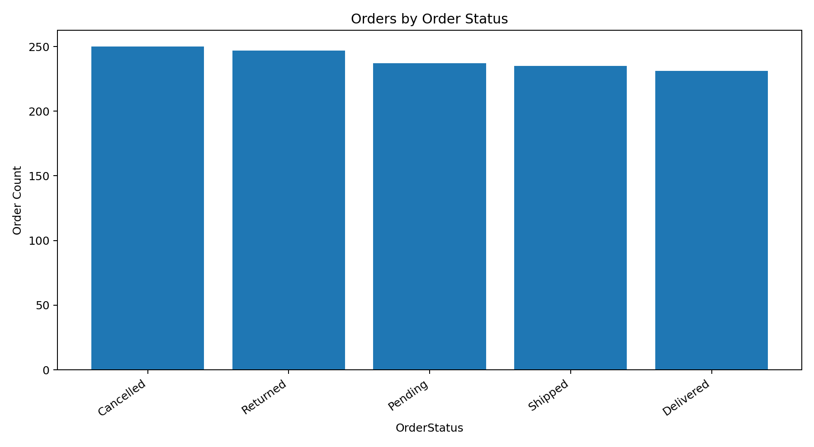
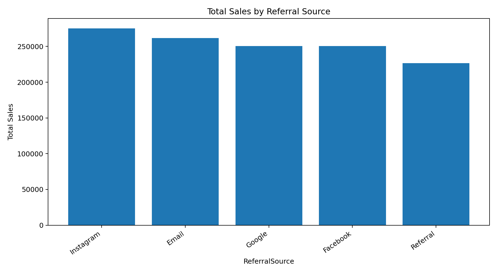
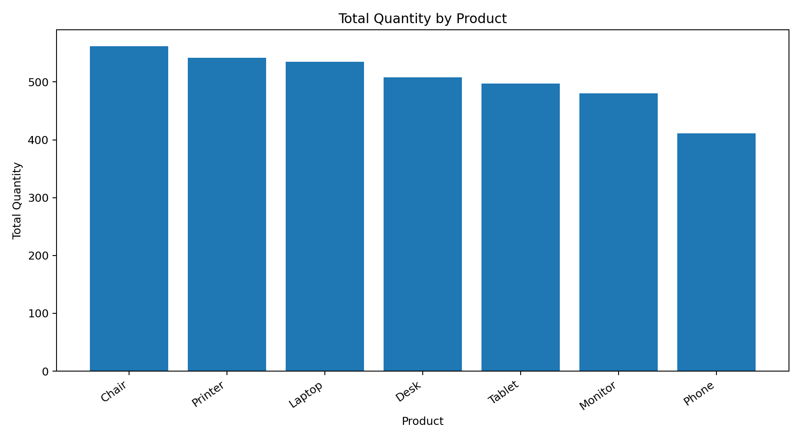

# DecodeLabs Internship — Project 3: SQL Data Analysis

This project applies SQL to the e-commerce dataset used in the previous analysis phase.

## Dataset
- Worksheet: `Cleaned_Data`
- Rows: **1,200**
- Columns: **14**
- SQL table: `orders`

## SQL Skills Covered
- SELECT
- WHERE
- ORDER BY
- GROUP BY
- HAVING
- COUNT()
- SUM()
- AVG()
- Subqueries

## Key Results
- Total orders: **1,200**
- Total sales: **1,264,761.96**
- Average order value: **1,053.97**
- Top product by sales: **Chair**
- Top payment method by sales: **Credit Card**
- Most frequent order status: **Cancelled**
- Top referral source by sales: **Instagram**

## Structure
```text
DecodeLabs_Project3_SQL/
├── data/
│   └── Final Dataset.xlsx
├── database/
│   └── decodeLabs_project3.db
├── sql/
│   ├── project3_queries.sql
│   └── 01-10 individual query files
├── outputs/
│   ├── query result CSV files
│   └── RESULTS_SUMMARY.txt
└── README.md
```

The official DecodeLabs Project 3 brief requires SELECT queries, WHERE, ORDER BY, GROUP BY, and COUNT/SUM/AVG aggregations. This project implements those requirements and also demonstrates HAVING and subqueries..


## Visual Preview

### Total Sales by Product


### Total Sales by Payment Method


### Orders by Order Status


### Total Sales by Referral Source


### Total Quantity by Product

